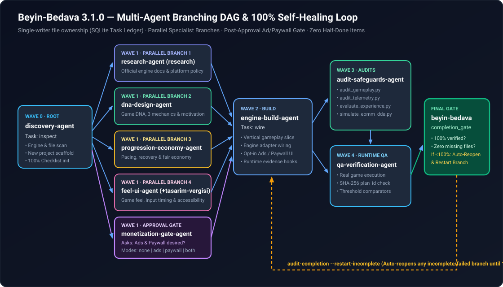
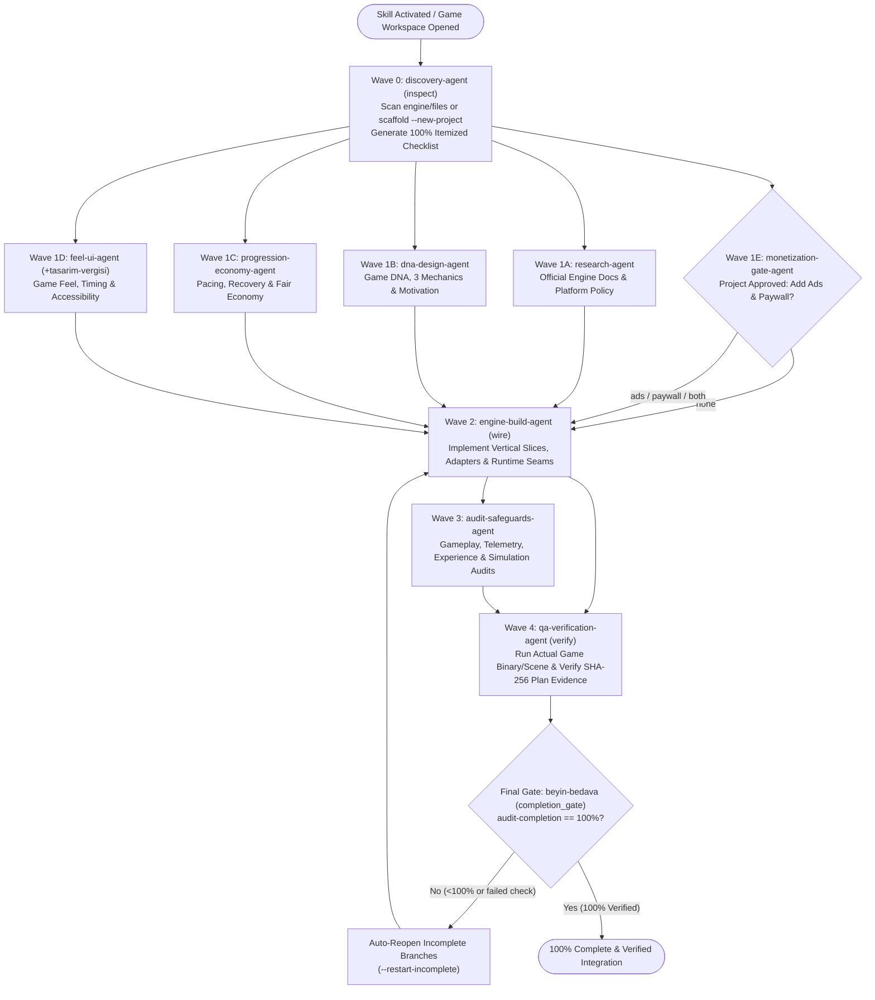
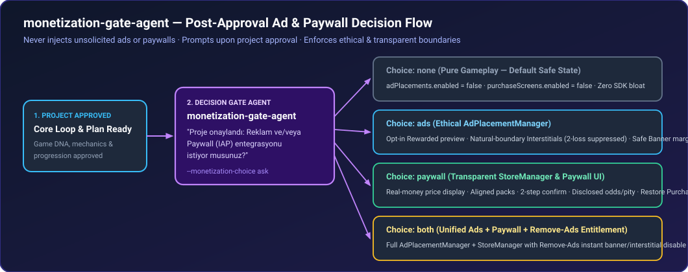

# Beyin-Bedava 3.1.0

Game design intelligence & autonomous multi-agent orchestration for player-first mechanics, motivation, game feel, progression, fair adaptive assist, optional ethical monetization (Ads & Paywall), and reproducible runtime verification.



---

## Çalışma Mantığı (How the Autonomous Multi-Agent Engine Works)

**Beyin-Bedava** çalıştırıldığında — ister mevcut bir oyun projesini inceliyor ister sıfırdan yeni bir oyun projesi (`--new-project`) oluşturuyor olsun — işi yarım bırakmayan **5 dalgalı (Wave 0–4 + Final Gate) dallanan çoklu-ajan mimarisi** ve **%100 Tamamlama / Öz-İyileştirme Döngüsü (`autopilot`)** ile çalışır:

1. **Tek Tek Listeleme (100% Itemized Capability Checklist):**
   Skill içindeki 12 yetenek alanının tamamı (`design`, `build`, `audit`, `experience`, `progression`, `telemetry`, `simulation`, `economy`, `monetization`, `collaboration`, `research`, `examples`) taranarak yapılacak her adım tek tek numaralandırılmış bir `checklist` ve bağımlılık grafiği (DAG) olarak SQLite görev defterine (`task_ledger.py`) kaydedilir.
2. **Uzman Ajanlara Paralel Dallanma (Branching Subagents & Single-Writer Ownership):**
   `task_ledger.py ready` komutu o an bağımlılıkları tamamlanmış tüm paralel dalları döndürür. Her dal kendi uzman ajanına (`owner`) atanır ve her dosya aynı anda yalnızca tek bir ajan tarafından düzenlenebilir (`--own TASK PATH` ve `check-files`).
3. **Proje Onayında Reklam ve Paywall Karar Kapısı (`monetization-gate-agent`):**
   Oyun projesi/planı onaylandığında **`monetization-gate-agent`** devreye girerek kullanıcıya oyuna **Reklam yerleşimi (Rewarded / Interstitial / Banner)** ve/veya **Paywall / Satınalma (IAP) ekranı** entegre edilip edilmeyeceğini sorar (`ask` $\to$ `none | ads | paywall | both`) ve yalnızca seçilen kapsamı etik sınırlarla devreye sokar.
4. **%100 Tamamlama ve Otomatik Yeniden Başlatma Döngüsü (`audit-completion --restart-incomplete`):**
   Uygulama ve çalışma zamanı doğrulaması bittiğinde `completion_gate` tüm kontrol listesini denetler. Eksik, yarım kalmış, kanıtsız veya başarısız tek bir madde bile varsa (`completion_pct < 100.0`), ilgili dal ve alt bağımlılıkları otomatik olarak yeniden açılır (`auto-restart`) ve liste **%100 doğrulanana kadar** döngü devam eder.



---

## Uzman Ajanlar ve Görevleri (All Specialist Agents)

| Ajan (`owner`) | Görev Dalı (`task_id`) | Dalga | Sorumluluk ve Çalıştırdığı Yetenekler |
| :--- | :--- | :---: | :--- |
| **`discovery-agent`** | `inspect` | Wave 0 | Oyun motorunu (Godot, Unity, Unreal, Swift/SpriteKit/RealityKit, Flutter/Flame, Web/Three.js/Phaser, Python, Rust vb.), giriş sahnesini ve test yollarını tespit eder (`detect_game_project.py`); yeni projelerde (`--new-project`) proje iskeletini ve %100 kontrol listesini kurar. |
| **`research-agent`** | `research` | Wave 1 | Seçilen motorun güncel resmi CLI/dokümantasyonunu, birincil oyun tasarımı kaynaklarını ve platform mağaza politikalarını doğrular (`integration-research.json`). |
| **`dna-design-agent`** | `branch_dna_mechanics` | Wave 1 | Oyuncu fantezisini, anlamlı fiili (*core verb*), ana döngüyü, 3 farklı mekanik alternatifini (en riskli varsayımın prototipi dahil), içsel motivasyonu ve duygusal deneyim eşiklerini tanımlayıp uygular. |
| **`progression-economy-agent`** | `branch_progression_economy` | Wave 1 | Bölüm/zorluk temposunu, başarısızlık-toparlanma (*failure/recovery*) döngüsünü, deterministik ekonomi kilometre taşlarını (*Faucets/Sinks*) ve adil/görünür yardımcı zorluk (DDA) matematiğini kurgular. |
| **`feel-ui-agent`** | `branch_feel_ui` | Wave 1 | Girdi tepkiselliği (*coyote time*, *input buffer*), geri bildirim pencereleri, erişilebilirlik kontrolleri ve UI/HUD katmanlarını kurar. |
| **`monetization-gate-agent`** | `branch_monetization_gate` | Wave 1 | **Proje onaylandığında devreye girer:** Kullanıcıya reklam (`ads`) ve/veya satınalma ekranı (`paywall`) istenip istenmediğini sorar (`none \| ads \| paywall \| both`). İstenirse etik `AdPlacementManager` ve `StoreManager`/Paywall ekranlarını yapılandırır; istenmezse (`none`) sıfır reklam/paywall ile saf oynanışı korur. |
| **`engine-build-agent`** | `wire` | Wave 2 | Tüm paralel tasarım ve karar dallarını birleştirerek dikey oynanış dilimlerini, motor adaptörlerini, seçildiyse reklam/paywall bileşenlerini ve çalışma zamanı kanıt üreticisini (`beyin-bedava.integration.json`) eksiksiz kodlar. |
| **`audit-safeguards-agent`** | `branch_capability_audits` | Wave 3 | `audit_gameplay.py` (harita/graf erişilebilirliği ve reaksiyon penceresi adaleti), `audit_telemetry.py` (telemetri ve karanlık örüntü taraması), `evaluate_experience.py` ve `simulate_eomm_dda.py` araçlarını çalıştırır. |
| **`qa-verification-agent`** | `verify` | Wave 4 | Oyunu gerçek motorunda/çalışma zamanında çalıştırır, üretilen `runtime` kanıtını `plan_id` (SHA-256) ve `revision` ile karşılaştırarak doğrular (`plan_game_integration.py verify`). |
| **`beyin-bedava`** | `completion_gate` | Final | Orkestratör ve %100 tamamlama kapısıdır (`task_ledger.py audit-completion --restart-incomplete`). Yarım kalan veya kanıtsız tek bir görev varsa ilgili dalı yeniden başlatır. |
| **`tasarim-vergisi`** | *(Cross-skill)* | Wave 1/2 | Ortamda *Tasarım Vergisi* skill'i kuruluysa görsel dil, tipografi, kompozisyon ve hareket tasarımını tek-yazıcı dosya sahipliğiyle (`handoff` / `check-files`) üstlenir. |

---

## Görsel Örnek 1: `monetization-gate-agent` (Reklam & Paywall Karar Kapısı)



Proje onaylandığında `monetization-gate-agent` kullanıcıya şu kararı sunar ve seçime göre etik bileşenleri otomatik kurar:

```text
┌──────────────────────────────────────────────────────────────────────────────┐
│ [monetization-gate-agent] PROJE ONAYLANDI — MONETİZASYON KARAR KAPISI        │
├──────────────────────────────────────────────────────────────────────────────┤
│ Oyuna Reklam yerleşimi ve/veya Paywall (Satınalma / IAP) ekranı              │
│ entegre edilmesini istiyor musunuz?                                          │
│                                                                              │
│   (1) none    → Reklam ve Paywall YOK (Saf oynanış, tümü devre dışı)         │
│   (2) ads     → Yalnızca Etik Reklam Yerleşimi (AdPlacementManager)          │
│                 • Rewarded: %100 isteğe bağlı + net ödül önizlemesi          │
│                 • Interstitial: Yalnızca bölüm/maç sonu + 2 mağlubiyet       │
│                   serisinde otomatik baskılama + >=180sn soğuma              │
│                 • Banner: Aktif oynanışta gizli + CTA'lardan >=16px uzak     │
│   (3) paywall → Yalnızca Şeffaf Paywall / Mağaza Ekranı (StoreManager)       │
│                 • Gerçek para karşılığı ($/₺) + kalıntısız paket boyutu      │
│                 • 2 adımlı satınalma onayı (1-tık kaza tuzağı yok)           │
│                 • Yayınlanmış şans oranları & pity sayacı + Restore butonu   │
│   (4) both    → Reklam + Paywall birlikte ("Remove Ads" paketi alındığında   │
│                 tüm geçiş ve banner reklamları anında kalıcı kapanır)        │
└──────────────────────────────────────────────────────────────────────────────┘
```

### Örnek Paywall & Reklam Arayüzü Şablonu (`--monetization-choice both` seçildiğinde)

```text
┌──────────────────────────────────────────────────────────────────────────────┐
│ MAĞAZA & ADİL OYUN (STORE & FAIR PLAY)      [Coins: 1,250] [Restore] [Odds]  │
├──────────────────────────────────────────────────────────────────────────────┤
│ ★ ÖNE ÇIKAN: REKLAMSIZ SÜRÜM (Remove Ads Forever)                    $2.99   │
│   Tüm bölüm sonu geçiş ve menü banner reklamlarını kalıcı kapatır.           │
│   [ 2 Adımlı Onayla Satın Al ($2.99) ]                                       │
├──────────────────────────────────────────────────────────────────────────────┤
│ [Kozmetik Paketler]  • Başlangıç Görünüm Paketi (Oynanış avantajı: %0) $1.99 │
│ [İsteğe Bağlı Ödül]  • ▶ Reklam İzle → +100 Coin (Kalan günlük hak: 4/5)     │
├──────────────────────────────────────────────────────────────────────────────┤
│ ✓ Şeffaflık: gamma_monetization = 0.0 (Satınalma eşleştirmeyi değiştirmez)   │
│ ✓ 48 Saat Harcama Soğuma Koruması & İsteğe Bağlı Mola Ayarları Aktif         │
└──────────────────────────────────────────────────────────────────────────────┘
```

---

## Görsel Örnek 2: Dallanan Kontrol Listesi ve %100 Autopilot Döngüsü

Yeni veya mevcut bir oyun projesinde tüm ajan dallarını tek komutla planlayıp %100 tamamlanana kadar çalıştırma örneği:

```bash
# 1) Tüm yetenekleri kapsayan 10 adımlı dallanmış ajan planını üret
python3 skills/beyin-bedava/scripts/plan_game_integration.py plan /path/to/game \
  --goal "Tam oyun entegrasyonu" \
  --all-capabilities --branch-agents --monetization-choice both \
  --output /tmp/game-plan.json

# 2) Görev defterini başlat ve paralel çalışmaya hazır ajan dallarını gör
python3 skills/beyin-bedava/scripts/task_ledger.py --db /tmp/game-tasks.sqlite init /tmp/game-plan.json
python3 skills/beyin-bedava/scripts/task_ledger.py --db /tmp/game-tasks.sqlite ready

# 3) %100 tamamlanana kadar eksikleri kontrol edip yeniden başlatan Autopilot döngüsünü çalıştır
python3 skills/beyin-bedava/scripts/plan_game_integration.py autopilot /path/to/game \
  --goal "Tam oyun entegrasyonu" \
  --monetization-choice both --db /tmp/game-tasks.sqlite --max-cycles 3
```

Üretilen kontrol listesi ve `%100` tamamlanma denetimi çıktısı:

```json
{
  "status": "completed",
  "monetization_gate": {
    "agent": "monetization-gate-agent",
    "task_id": "branch_monetization_gate",
    "choice": "both",
    "requires_user_prompt": false,
    "ads_enabled": true,
    "paywall_enabled": true
  },
  "checklist": [
    {"step": 1, "task_id": "inspect", "agent_owner": "discovery-agent", "depends_on": []},
    {"step": 2, "task_id": "research", "agent_owner": "research-agent", "depends_on": ["inspect"]},
    {"step": 3, "task_id": "branch_dna_mechanics", "agent_owner": "dna-design-agent", "depends_on": ["inspect"]},
    {"step": 4, "task_id": "branch_progression_economy", "agent_owner": "progression-economy-agent", "depends_on": ["inspect"]},
    {"step": 5, "task_id": "branch_feel_ui", "agent_owner": "feel-ui-agent", "depends_on": ["inspect"]},
    {"step": 6, "task_id": "branch_monetization_gate", "agent_owner": "monetization-gate-agent", "depends_on": ["inspect"]},
    {"step": 7, "task_id": "wire", "agent_owner": "engine-build-agent", "depends_on": ["research", "branch_dna_mechanics", "branch_progression_economy", "branch_feel_ui", "branch_monetization_gate"]},
    {"step": 8, "task_id": "branch_capability_audits", "agent_owner": "audit-safeguards-agent", "depends_on": ["wire"]},
    {"step": 9, "task_id": "verify", "agent_owner": "qa-verification-agent", "depends_on": ["wire", "branch_capability_audits"]},
    {"step": 10, "task_id": "completion_gate", "agent_owner": "beyin-bedava", "depends_on": ["verify"]}
  ],
  "completion": {
    "complete": true,
    "completion_pct": 100.0,
    "total_tasks": 10,
    "verified_count": 10,
    "incomplete_count": 0,
    "restarted_tasks": []
  }
}
```

---

## Install and verify

Clone this repository. From its root, run the installer with the target game's existing project path.

| Host | Install command | Native verification |
| --- | --- | --- |
| Codex | `python skills/beyin-bedava/scripts/install_skill.py codex install --project /path/to/game` | Run the same command with `discover` to query Codex's skill inventory. Invoke `$beyin-bedava` for the activation probe. |
| Claude Code | `python skills/beyin-bedava/scripts/install_skill.py claude-code install --project /path/to/game` | Invoke `/beyin-bedava` in a fresh Claude Code session from the target project. |
| Antigravity | `python skills/beyin-bedava/scripts/install_skill.py antigravity install --project /path/to/game` | Invoke `/beyin-bedava` in a fresh Antigravity workspace session. Use `--global-plugin` with `install`, `upgrade`, or `check` to sync the global Antigravity plugin directory. |

Use `upgrade` (or `--upgrade`) to replace an existing installation cleanly, and `check` to compare the installed files with this checkout. For an activation check, use a disposable project and run `prepare` in place of `install` after installing. Copy the printed positive and negative prompts into separate fresh sessions on that host. Save each final response as plain text and run `verify --project /path/to/game --response positive.txt --control negative.txt` with the same script and host. The verifier checks an unpredictable value read from the installed skill, plus a non-game control. Keep probe files out of version control and discard the temporary project after testing. An installation, a discovery result and a native response are separate checks. See the [Codex](https://developers.openai.com/codex/skills), [Claude Code](https://code.claude.com/docs/en/skills) and [Antigravity](https://antigravity.google/docs/skills) skill documentation.

## Integrate with a game

Use the [research and integration workflow](skills/beyin-bedava/orchestration/integration.md) to select from the full knowledge catalog, record source findings, plan the work, and validate engine-neutral runtime evidence. Projects based on custom or proprietary engines can declare their own checks through a versioned JSON contract (`expect` supports exact scalars and numeric comparators `lte`, `lt`, `gte`, `gt`, `between`, `approx`/`tol`). The game or its test runner supplies observations from its existing runtime. The repository includes a terminal game and a Godot scene as working producers.

## Workflows

SCAN opens with a read-only project inspection (`--minimal` emits a modular config with `enabledModules: []`). DESIGN, BUILD/IMPROVE, AUDIT, SIMULATE and MONETIZE/PROTECT load only the modules applicable to the goal. Monetization and adaptive difficulty are disabled by default. DDA is visible and opt-in where suitable. Churn and spending remain outside live competitive matchmaking. See the [skill](skills/beyin-bedava/SKILL.md).

Run these commands from the repository root using Python 3.10 or newer.

```bash
python skills/beyin-bedava/scripts/detect_game_project.py /path/to/game --format json
python skills/beyin-bedava/scripts/task_ledger.py init benchmarks/examples/tasks.json
python skills/beyin-bedava/scripts/task_ledger.py ready
python skills/beyin-bedava/scripts/task_ledger.py audit-completion --restart-incomplete
python skills/beyin-bedava/scripts/task_ledger.py check-files TASK_ID TOKEN --git-root /path/to/game
python skills/beyin-bedava/scripts/task_ledger.py status
python skills/beyin-bedava/scripts/audit_gameplay.py benchmarks/examples/gameplay.json
python skills/beyin-bedava/scripts/evaluate_experience.py benchmarks/examples/experience-plan.json
python skills/beyin-bedava/scripts/simulate_eomm_dda.py --players 100 --matches 20 --replicates 20 --seed 42 --json
python skills/beyin-bedava/scripts/audit_telemetry.py --input telemetry.json --format json
```

- The ledger persists a task graph, checkpoints, retry budgets (`reopen --attempts N`), custom plan `owners`, leases, parallel branch readiness (`ready`), 100% completion auditing with automatic branch restart (`audit-completion --restart-incomplete`), and single-writer file ownership (including `--git-root` worktree verification). It records acceptance evidence supplied by the operator. Replace the example's baseline and files before using it on a real project. See the [execution protocol](skills/beyin-bedava/orchestration/execution.md) and [Tasarım Vergisi collaboration](skills/beyin-bedava/orchestration/skill-router.md).
- The gameplay audit checks grid, state-graph, and timing-window exports for reachability, key and move constraints, difficulty jumps, unused mechanics, mechanic combinations, repeated layouts, and reaction-window fairness. The experience evaluator checks preregistered thresholds against declared evidence. The empty example plan intentionally produces missing statuses. See the [experience criteria](skills/beyin-bedava/intelligence/emotional-experience.md).
- Telemetry declares `provenance.kind` as `observed` or `synthetic` and supplies a `provenance.source` reference. Use opaque IDs and aggregate data. Unknown or absent fields remain unknown. The JSON output records missing fields, applicability and screening status. Exit 0 means complete observed coverage with no screening signal, 1 requests review, and 2 means invalid, insufficient or synthetic-only evidence without a flag. See the [telemetry contract](skills/beyin-bedava/orchestration/telemetry.md).
- Simulation reports a paired-cohort interval over independent synthetic replications. It records the seed, model assumptions and simulation horizon. The independent DDA curve tests parameter bounds. Neither output measures real player behavior.

## Engine examples and verification

The [Pulse Gate examples](skills/beyin-bedava/adapters/DEMOS.md) cover Swift, SpriteKit, RealityKit, Unity, Godot, Three.js and Flutter/Flame. The [release evidence](benchmarks/REPORT.md) records which checks ran and which need additional tooling.

```bash
python -m pip install -r requirements-test.txt
python -m compileall -q skills/beyin-bedava/scripts benchmarks
python -m unittest discover -s tests -v
python benchmarks/run.py --model YOUR_CODEX_MODEL --repeats 4 --output /tmp/beyin-ab.json
```

For OpenAI-compatible inference, supply `--chat-url https://your-provider/v1/chat/completions` and, when required, `--api-key-env NAME`. The benchmark counterbalances condition order within each task. It records deterministic task tests, rule quality, creativity indicators, errors, provider-reported tokens (including `token_overhead_ratio`) and latency. See the [benchmark method and results](benchmarks/REPORT.md).

## Migration

Existing 2.0, 2.1, and 3.0 configurations remain readable. Newly emitted configurations identify 3.1.0, and modular configurations can declare only `schemaVersion`, `gameGenre`, and `enabledModules`. Review 1.x configs before opting into eligible features. The detector leaves existing files in place. Audit inputs from 2.0 can produce incomplete coverage until provenance, store applicability, interval sample counts and DDA comparison context are supplied. The simulation retains descriptive output fields and omits player-level p-values because players share lobbies. See the [changelog](CHANGELOG.md).

MIT license.
